# redmine_non_working_days

A Redmine plugin that manages non-working days — public holidays, custom fixed dates, and recurring rules — and reflects them in Gantt charts and an external REST API.

## Features

- **Public holiday import** — fetch public holidays per country/year via the [Nager.Date](https://date.nager.at/) API and register them with one click
- **Japanese substitute holidays** — when importing holidays for Japan, substitute holidays (振替休日) and citizens' holidays (国民の休日) are completed automatically, and holidays the API shifted to their observed date are restored to their statutory date ([details](#japanese-holidays-jp-only))
- **Custom fixed dates** — register one-off non-working days (e.g. summer/winter company holidays)
- **Recurring rules** — define repeating non-working days using one of four patterns, each with an optional valid date range:
  - Specific day(s) of the month (e.g. the 15th and the last day)
  - Last day of the month
  - Nth weekday of the month (e.g. 2nd Friday)
  - Biweekly on a given weekday
- **Gantt chart integration** — non-working days registered here are excluded from Gantt schedule calculations (standard Gantt and Easy Gantt) alongside Redmine's standard day-off settings
- **Issue calendar integration** — non-working days registered here are highlighted in Redmine's standard issue calendar (`/issues/calendar`) alongside Redmine's standard day-off settings
- **Calendar view** — yearly and monthly calendar views color-coded by kind (public holiday / fixed date / recurring rule / Redmine standard day off), with a "+N" popup for days with many entries
- **Bulk operations** — select-all checkboxes and bulk delete for each list, plus a one-click "delete all non-working day settings" option (with confirmation) that leaves Redmine's native day-off settings untouched
- **REST API** — `GET /non_working_days/api/days.json` lets external systems query non-working days by year or date range, authenticated with Redmine's standard API key
- **i18n** — English and Japanese included

## Tested Environment

| | Version |
|---|---|
| Redmine | 6.0.4.stable |
| Ruby | 3.3.8-p144 |
| Rails | 7.2.2.1 |
| Database | PostgreSQL |

> Other versions may work but have not been verified. Reports via Issues are welcome.

## Requirements

- Redmine 6.0 or higher (migrations target Rails 7.2, and asset delivery relies on Redmine 6's Propshaft-based plugin asset pipeline; tested on 6.0.4)

## Demo

[](https://youtu.be/QjWZld_j7vI)


## Screenshots

### Administration — Non-Working Days List
| English | Japanese |
|---|---|
| 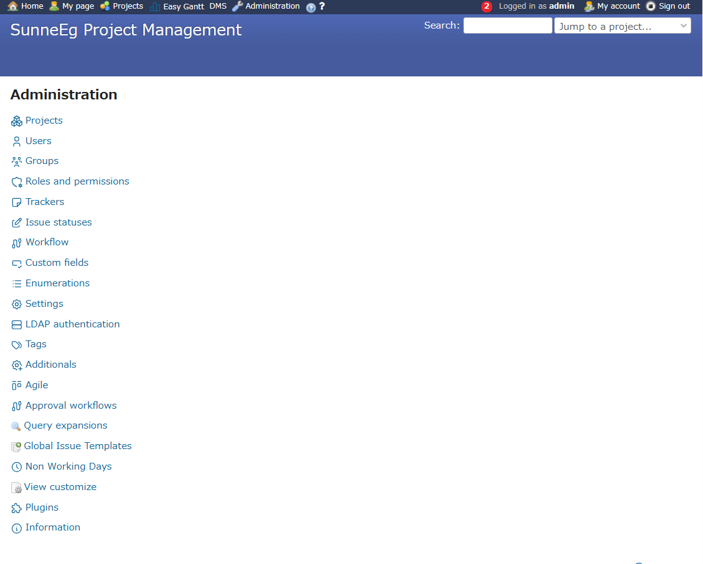 | 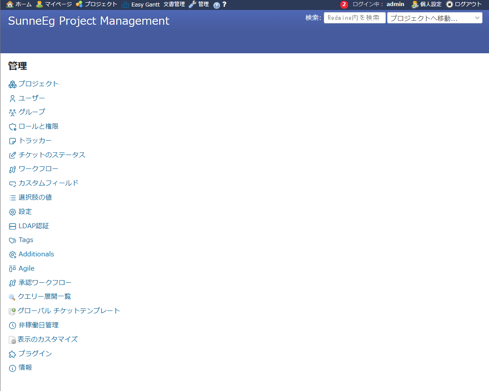 |

### Plugin Settings
| English | Japanese |
|---|---|
| 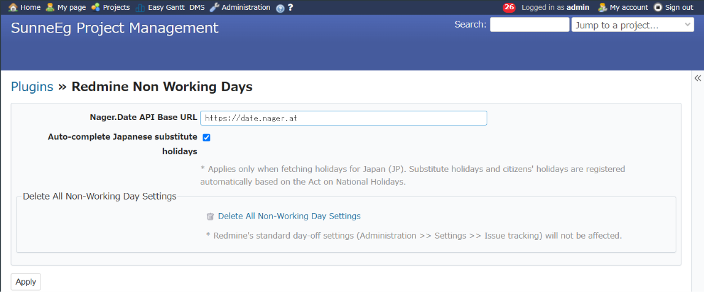 | 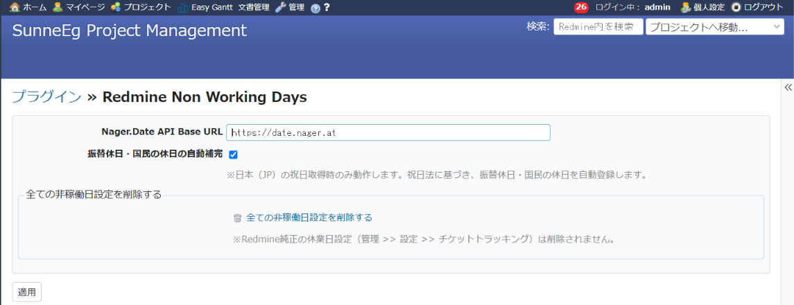 |

### Non-Working Days — Overview
| English | Japanese |
|---|---|
| 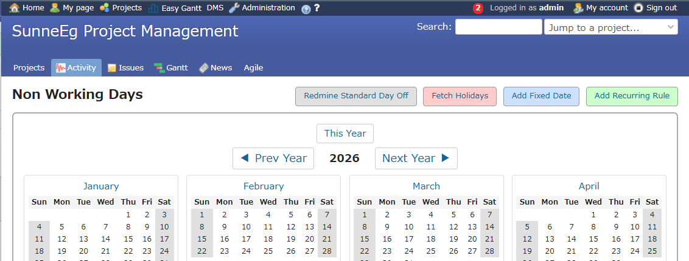 | 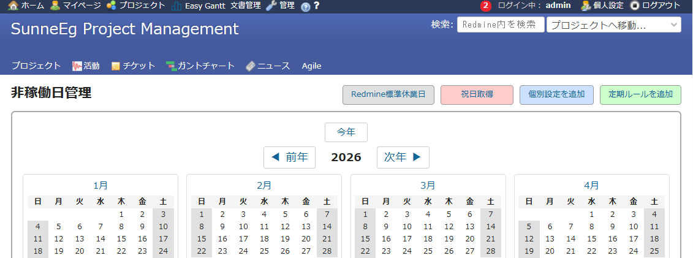 |

### Fetch Public Holidays
| English | Japanese |
|---|---|
| 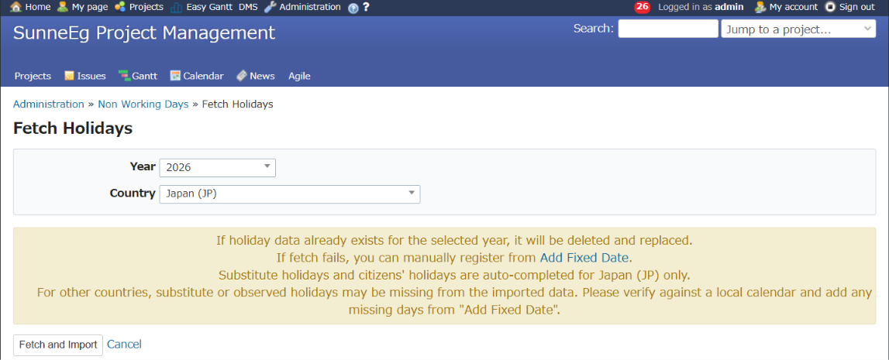 | 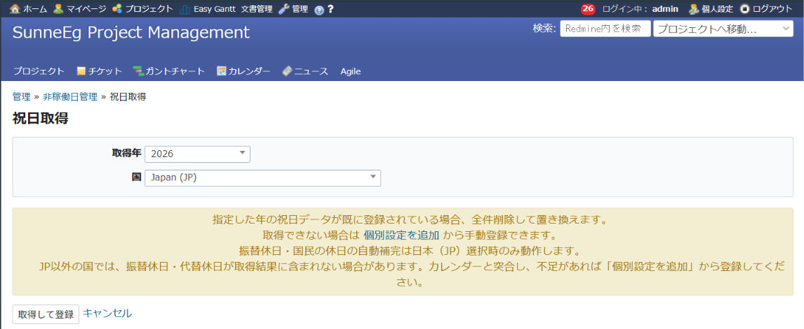 |

### Add Fixed Date
| English | Japanese |
|---|---|
| 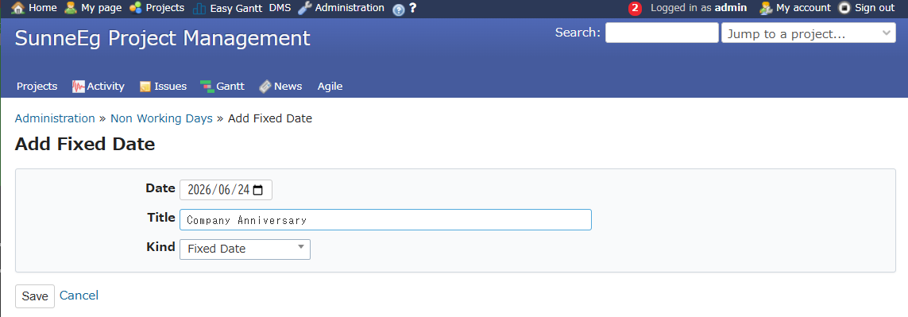 | 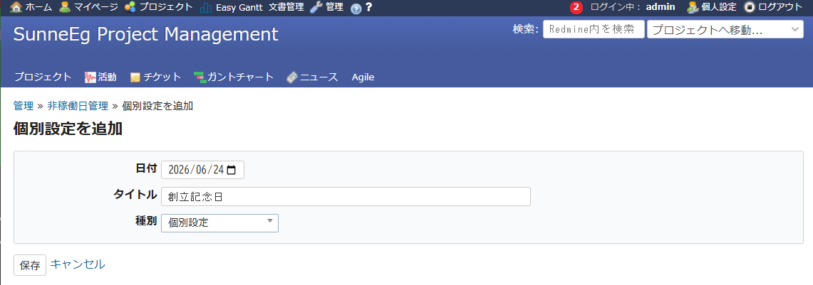 |

### Add Recurring Rule
| English | Japanese |
|---|---|
| 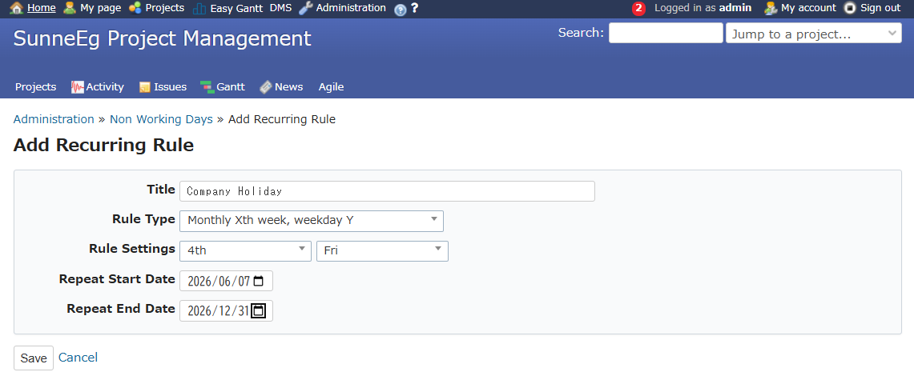 | 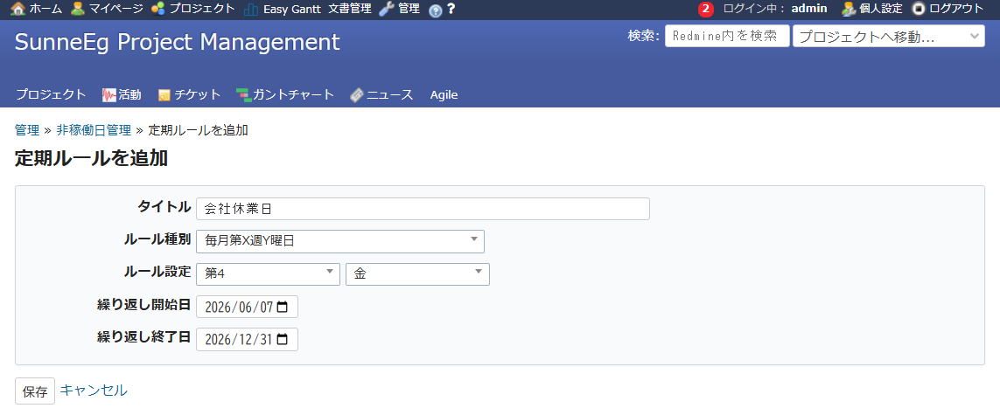 |

### Non-Working Days — Full List
| English | Japanese |
|---|---|
| 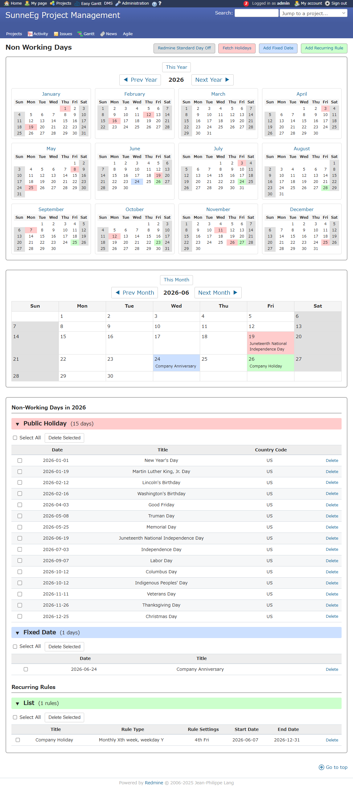 | 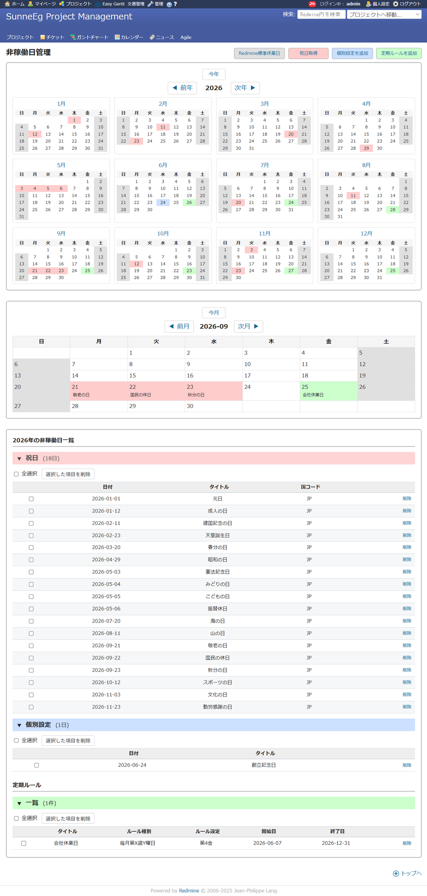 |

### Standard Gantt Integration
| English | Japanese |
|---|---|
| 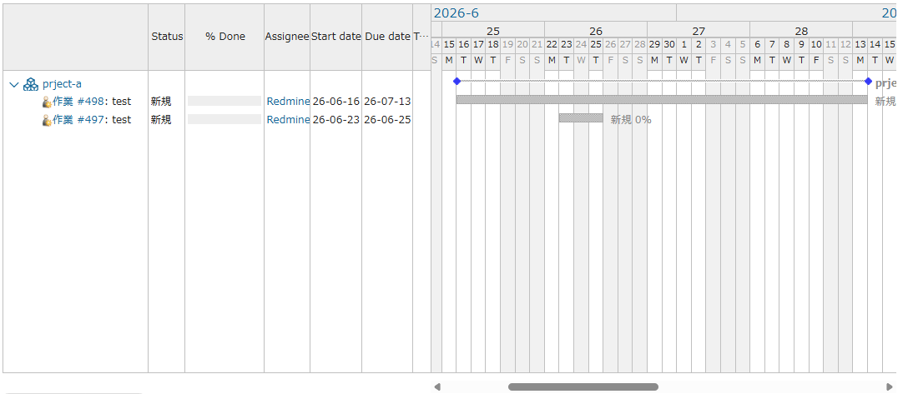 | 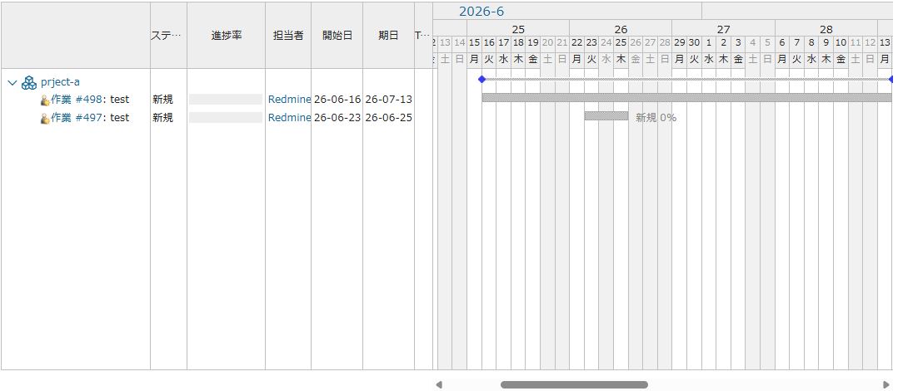 |

### Easy Gantt Integration
| English | Japanese |
|---|---|
| 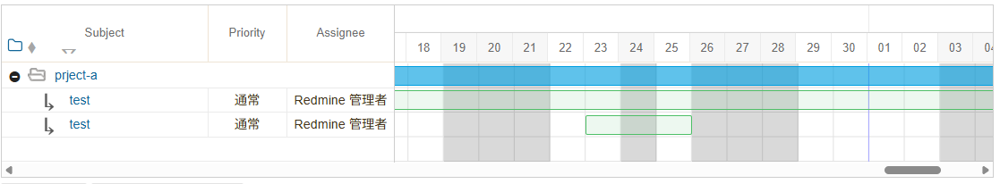 | 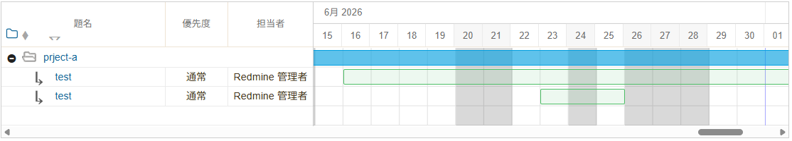 |

## Installation

1. Clone this repository into your Redmine `plugins` directory:

   ```bash
   git clone https://github.com/SunnyEg-lab/redmine_non_working_days.git /path/to/redmine/plugins/redmine_non_working_days
   ```

2. Run database migrations:

   ```bash
   bundle exec rake redmine:plugins:migrate RAILS_ENV=production
   ```

3. Restart Redmine.

## Permissions

This plugin adds an entry under the **Administration** menu. Viewing and editing non-working days is available to administrators only; no per-project permissions are added.

## Settings

Go to **Administration → Plugins → Redmine Non Working Days** to configure:

- **Nager.Date API Base URL** — the base URL used to fetch public holiday data (defaults to `https://date.nager.at`)
- **Auto-complete Japanese substitute holidays** — when importing holidays for Japan (JP), restore statutory dates and register substitute/citizens' holidays automatically (enabled by default; see [Japanese Holidays (JP only)](#japanese-holidays-jp-only))
- **Delete All Non-Working Day Settings** — a one-click option (with confirmation) to remove all holidays, fixed dates, and recurring rules registered by this plugin; Redmine's native day-off settings (Administration → Settings → Issue tracking) are not affected

> **Cache note:** In a multi-process environment (e.g. Passenger/Puma with multiple workers, multiple app servers), the default `:memory_store` is not shared between processes. Configure a shared cache store such as `:file_store` or `:mem_cache_store` if you run Redmine with multiple processes.

## Japanese Holidays (JP only)

Japan's Act on National Holidays grants two kinds of days off that are not national holidays themselves:

- **Substitute holiday (振替休日)** — when a national holiday falls on a Sunday, the nearest following day that is not a national holiday becomes a day off (Article 3(2))
- **Citizens' holiday (国民の休日)** — a day sandwiched between two national holidays becomes a day off, unless it is a Sunday or already a substitute holiday (Article 3(3))

The Nager.Date API returns neither of them for Japan. Instead it shifts a Sunday holiday to its observed date and returns a single entry, which drops the statutory date:

| Year | Nager.Date returns | Correct under Japanese law |
|---|---|---|
| 2024 | nothing on `09-23` | `09-22` Autumnal Equinox Day (Sun) + `09-23` substitute holiday |
| 2025 | `02-24` "天皇誕生日" | `02-23` The Emperor's Birthday + `02-24` substitute holiday |
| 2026 | `05-06` "憲法記念日" | `05-03` Constitution Memorial Day + `05-06` substitute holiday |
| 2026 | nothing on `09-22` | `09-22` citizens' holiday |

That "shift and return one entry" model is correct for countries where only the observed day is a statutory day off (the UK and the US, for example), but not for Japan, where the statutory date stays a holiday and the substitute day is added on top of it.

When **JP** is selected, this plugin post-processes the fetched data in two steps:

1. **Restore statutory dates** — holidays the API shifted to their observed date are moved back. To avoid corrupting correct data this is applied only when the holiday's name matches a known fixed-date holiday, the statutory date falls on a Sunday, and the API returned a later date. Anything else is left untouched, so an unrecognised name simply falls back to the API's own result.
2. **Derive days off** — substitute holidays and citizens' holidays are computed per Article 3(2) and 3(3), and registered alongside the fetched holidays.

Generated entries use `kind: holiday`, the same as fetched holidays, and are titled using the instance's default language (振替休日 / Substitute Holiday, 国民の休日 / Citizens' Holiday). Because an import replaces every holiday of the target year, re-importing is idempotent — generated entries are refreshed as well, never duplicated.

Set this behaviour on or off in the plugin settings (see [Settings](#settings)).

> **Note:** This correction assumes the fetched holiday data is itself correct for the requested year. Nager.Date's JP data has been checked against Japan's official holiday calendar for 2016 through 2027 (Japan's Cabinet Office does not publish official holiday data further ahead than this — 2028's holidays, for example, are only published in February 2027), except for the 2019 accession holidays and the 2020/2021 Olympic date shifts, which it does not reflect. (Separately, the Sunday-holiday shift this correction depends on has been spot-checked through 2035 with no issues found, but full-year accuracy beyond 2027 has not been verified against an official source.) For years before 2016, the API retroactively applies rules that didn't exist yet (e.g. returning "Happy Monday" dates, or Mountain Day, before those rules/holidays existed), which can make this plugin derive a citizens' holiday that never legally existed. If you import an older year or a year with a known exception, verify the result against an authoritative calendar.

### Other countries

For any country other than JP, imported data is registered exactly as the API returns it. No correction or completion is applied, even when the setting above is enabled.

Substitute-holiday rules differ from country to country: some substitute only for Sunday, others for Saturday as well; some move the day off backwards to the preceding Friday; some grant both the statutory date and the substitute. Handling each correctly requires that country's law, so this plugin does not attempt it. Verify the imported result against a local calendar and add any missing days as fixed dates.

## REST API

```
GET /non_working_days/api/days.json
```

| Parameter | Required | Description | Example |
|---|---|---|---|
| `year` | optional | Target year (defaults to current year) | `2026` |
| `from` / `to` | optional | Date range (`YYYY-MM-DD`); takes precedence over `year` | `2026-04-16` / `2027-04-15` |
| `kind` | optional | Filter by kind, comma-separated | `holiday,custom_fixed` |

Each returned entry has `date`, `title`, `kind`, and `country_code`. Possible `kind` values:

| Kind | Source | Notes |
|---|---|---|
| `holiday` | `NonWorkingDayEntry` (imported or manually added) | `country_code` set when imported from Nager.Date |
| `custom_fixed` | `NonWorkingDayEntry` (manually added) | `country_code` always `null` |
| `custom_recurring` | `NonWorkingDayRule` | Expanded on the fly for the requested range; `country_code` always `null` |
| `weekday` | Redmine core's **Administration → Settings → Issue tracking → Non-working days** setting | Not managed by this plugin; `title` is the localized day name (e.g. "Saturday"), generated using the instance's default language. `country_code` always `null` |

**When `kind` is omitted, all four kinds above are included**, `weekday` among them. Pass an explicit `kind` (e.g. `kind=holiday,custom_fixed,custom_recurring`) to exclude the core weekday setting from the response.

If the same date matches more than one kind (e.g. a holiday that also falls on a `weekday`-designated day of week), **all matching entries are returned as separate rows** — the response is not deduplicated per date. Rows are sorted by `date`, then by kind priority (`holiday` > `custom_fixed` > `custom_recurring` > `weekday`), then alphabetically by `title`, so the ordering is deterministic across calls. Callers that want a single row per date (e.g. to store in a table keyed by date) need to pick one themselves, e.g. by taking the first row per date after this sort.

Authenticate with Redmine's standard REST API key, either via the `X-Redmine-API-Key` header or a `key` query parameter. The REST API must be enabled in **Administration → Settings → API**.

> **Access note:** Unlike the plugin's admin screens, this endpoint is available to **any logged-in Redmine user** (not administrators only) — anyone with a valid account and API key can query it with their own key. There is no per-project or per-role permission gate. If you need to restrict access further, consider fronting the endpoint with a reverse-proxy rule or requesting a dedicated permission in an Issue.

## License

This plugin is released under the same license as Redmine itself (GNU General Public License v2 or later).
